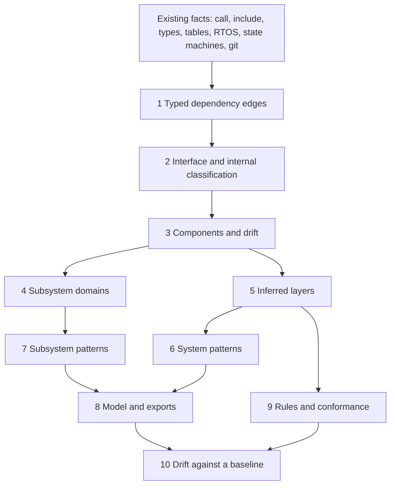

# Architecture recovery: design

> **Status:** implemented (#117 to #132). Each step has a tracking issue,
> listed under [Build order](#build-order). The tracking issue for the whole programme is #133.

## Purpose

FWLens already measures structure: the call graph, the include graph, module coupling, Martin
metrics, cycles, dispatch tables, RTOS objects, state machines, and change coupling from git. What it
does not do is turn those facts into a model of the architecture **as implemented**, say which
standard pattern that architecture follows, or check it against the architecture that was **intended**.

This design adds that, in four parts:

1. Recover the as-implemented model: components, layers, interfaces and typed dependencies.
2. Name the patterns in use, at two levels: the whole system, and each subsystem (UI, comms and so on).
3. Compare the implemented model with an intended one, and with an earlier run.
4. Export the model as docs-as-code (PlantUML and Structurizr DSL) and show it in the report.

The approach follows the reverse-engineering method in the Clang AST architecture note the project
was asked to compare against, adapted to what FWLens has: a lexical and `libclang` fact base, a
module graph, and a configuration file where the user can state what they know.

## Principles

- **Evidence, not verdicts.** Every finding carries its evidence and a confidence of high, medium or
  low, in the same way as the CBOM. A pattern is reported as "layered, high, 2 skip-layer edges",
  never as a bare label.
- **Inferred next to configured.** Inferred components and layers are shown beside the configured
  `layers:`, with the disagreements listed. They never replace what the user wrote.
- **The user can always override.** Anything inferred can be pinned or renamed in the configuration.
- **Reuse before adding.** New code uses the existing graph, RTOS, state machine and git data. New
  parsing is added only where the existing facts cannot answer the question.
- **No new dependencies.** Community detection (Louvain) uses `networkx`, which FWLens already depends on, with a
  fixed seed so runs are repeatable.

## What already exists

| Need | Already in FWLens | Gap |
| :--- | :--- | :--- |
| Call, include and module graphs | `build_call_graph`, `build_include_graph`, `build_module_dep_graph` | Edges have no kind or weight |
| Coupling and Martin metrics | `compute_module_coupling`, `compute_zone_metrics` | Computed per configured module only |
| Cycles | `detect_scc` | Not used to infer layers |
| Layer violations | `detect_arch_violations` | Needs configured `layers:` |
| Directory versus group alignment | `analyse_group_dir_alignment` | Not a drift measure against inferred components |
| Dispatch tables | `build_dispatch_table_index` | Not classified as interfaces |
| RTOS objects, state machines | `rtos_analysis.py`, `state_machines.py` | Not used as pattern evidence |
| Change coupling, hotspots, ownership, ISR shared state | Git history and `isr` analyses | Not grouped by subsystem |
| Mermaid and SVG diagrams | `output/diagrams.py` | No PlantUML or Structurizr, no inferred model |

## Pipeline



Each stage is a timed phase, so it shows up in the run timing table.

## Data model

New code lives in the `fwlens/arch/` package, which is empty today. The model is a set of plain
dataclasses, added to the project model and the JSON export under an `architecture` key.

| Type | Holds |
| :--- | :--- |
| `Edge` | source, target, kind, count, weight, and the evidence (a few file and line pairs) |
| `Component` | id, name, member files, how it was found (build target, community, configured), cohesion, drift score |
| `Interface` | the public surface of a component: header declarations, dispatch tables, abstract headers |
| `Leak` | an edge that reaches an internal symbol of another component |
| `Subsystem` | a component group with a domain, the evidence for the domain and its confidence |
| `PatternFinding` | pattern id, scope (system or subsystem), confidence, evidence lines, the files or components involved |
| `RuleResult` | rule id, status, and the edges or components that break it |

### Dependency kinds

| Kind | Meaning | Where it comes from |
| :--- | :--- | :--- |
| `call` | direct invocation | the existing call graph |
| `type` | a type used in a signature or return value | declarations in headers and definitions |
| `state` | a struct embedded in a struct, or a global read or written | member and variable declarations |
| `callback` | a function address stored or passed | dispatch tables, registrations, address-of in arguments |
| `include` | a header dependency | the include graph |

The default weights are `callback` 4, `state` 3, `type` 2, `call` 1 and `include` 0.5, all settable under
`architecture.weights`. The weights express coupling strength. Embedding another module's struct
binds layout and lifetime, while passing a `uint32_t` binds neither.

## Stage detail

### 1. Typed dependency edges

Extend graph construction so every edge keeps its kind and a count. The existing call and include
graphs stay as they are, and the typed edge set is built beside them from the same parse, so current
reports do not change. Tests use small fixture projects with one edge of each kind.

### 2. Interfaces and encapsulation

A symbol is **internal** when it has internal linkage (`static`), or is declared only in a header that
no other component includes. It is **public** when it is declared in a header another component
includes, or is a function-pointer struct (a dispatch table), or is an abstract header (a header of
declarations only). An edge from one component to an internal symbol of another is a `Leak`. This is
also the basis for the interface catalogue (the public surface per component, with fan-in, and exports
nobody uses).

### 3. Components and drift

1. Start from build targets and IDE groups where the project has them (CMake targets, IAR and Keil
   groups, Eclipse source folders).
2. Where there are none, or a group is too large, split with Louvain community detection on the
   weighted file graph. The result is deterministic: nodes are processed in sorted order and ties
   break by name.
3. Directory drift is the share of a file's weighted coupling that lies outside its directory's
   community. A file that sits in `drivers/` and has most of its coupling with `application/` is
   reported, with the numbers.

Configured modules and groups are always kept as a view. The inferred components are a second view
with the differences listed.

### 4. Subsystem domains

Each component is labelled with a domain from `fwlens/arch/domains.yaml`, using the same approach as
`crypto/keywords.yaml`:

- words in file, function and type names (`display`, `menu`, `uart`, `modbus`, `dlms`, `nvm`)
- the libraries and peripherals included or called (LVGL, emWin, lwIP, FatFs, HAL UART, SPI, I2C, CAN)
- the RTOS objects the component owns

The result is a domain, the evidence and a confidence. Components with no evidence are `unclassified`,
and the report says so. The configuration can pin a domain or define new ones.

### 5. Inferred layers

Condense the strongly connected components, then topologically sort the condensation to give a layer
number to every component. Cycles stay as one node and are reported. A back-edge relative to the
sort, or to the configured order, is a layer violation. Report:

- the inferred stack
- where it disagrees with the configured `layers:`
- the share of downward edges that go to the next layer and the share that skip layers, which
  distinguishes a strict layered design from a relaxed one

### 6. System patterns

Each pattern is scored from the evidence below. A score maps to a confidence, and several patterns can
hold at once, for example RTOS task-based and layered.

| Pattern | Evidence |
| :--- | :--- |
| Layered | Three or more inferred layers, few upward edges, high share of downward edges |
| HAL and ports and adapters | Interface headers or function-pointer structs with several implementations, and consumers that touch only the interface |
| Super-loop | `main` with an unbounded loop calling a fixed set of functions, with ISRs that only set flags or fill buffers |
| RTOS task-based | Tasks, queues, semaphores and priorities from the existing RTOS analysis, with the producer and consumer shape per queue |
| Event-driven or publish and subscribe | Registration calls that take an identifier and a function address, mapped from publisher to broker to subscriber |
| State machine, table-driven | The existing state machine detection, and tables indexed by state or event |
| Pipeline | A linear chain of components where each consumes the type the previous one produces |
| Plugin or driver registry | A table of operations structs registered at start-up |
| Big ball of mud (anti-pattern) | High coupling, many cycles, no usable layering |
| God component (anti-pattern) | One component with very high fan-in and fan-out and a large share of the code |

### 7. Subsystem patterns

Patterns are tested per subsystem, and only those that fit its domain. This is where the evidence can
be specific.

| Domain | Patterns and their evidence |
| :--- | :--- |
| UI | Retained widget tree (LVGL or emWin objects and callbacks). Screen state machine (a table of screens with enter and exit handlers). Menu table (arrays of structs with labels and handler pointers). Model and view split (display code reads shared data and never writes it). Event loop (one task draining a key or touch queue). Display driver layering (framebuffer, flush callback, driver) |
| Comms | Layered protocol stack (calls go down, callbacks go up). ISR, ring buffer and task. DMA double buffer. Frame parser state machine. Command dispatcher (a table from command identifier to handler). One task per interface. Gateway or bridge (one interface's receive path feeding another's transmit path) |
| Storage | Wear levelling or journal. Dual-bank or A and B image. Parameter store with a CRC and defaults |
| Power | Power-mode state machine, wake-source handlers |
| Metering and sensing | Sample, filter, compute and report pipeline |
| Cross-cutting | Watchdog and fault handler, logging sink, error-code propagation style |

Patterns and their evidence rules live in `fwlens/arch/patterns.yaml`, so a project can add its own
without changing code. A rule is a set of named signals with weights and a threshold, and the report
shows which signals fired.

### 8. Model and exports

- **Report:** a new Architecture view with the inferred layer stack, the system patterns, a
  subsystem tree (domain, patterns, evidence, confidence), the drift table, leaks, and the
  differences from the configured layers.
- **PlantUML:** components grouped in packages by layer, interfaces drawn as interfaces, violations in
  red.
- **Structurizr DSL:** subsystems as containers and components as components, so the C4 views
  can be loaded as they are.
- **JSON:** the whole model under `architecture`.

### 9. Rules and conformance

The user states the intended architecture in the configuration, and FWLens checks it.

```yaml
architecture:
  intended_layers: [app, services, middleware, hal]     # top to bottom
  rules:
    - id: ui-no-metering
      from: {domain: ui}
      to: {domain: metering}
      allow: false
    - id: hal-only-registers
      from: {not: {layer: hal}}
      to: {symbol: "*_REG_*"}
      allow: false
```

A command writes the inferred model as a starting baseline, so the first rules describe what exists
and are then tightened by hand. Violations are findings with severity, they work with the existing
baseline and ratchet gating, and a new cycle or layer breach can fail CI.

### 10. Drift against a baseline

Save the architecture model with a run and compare a later run with it, or with an earlier git revision:
new and removed components, edges that appeared, new cycles, layer breaches, subsystem coupling trend,
and components that moved. The existing run history and git history support are reused.

### Variants

Firmware is often one code base with several products, selected by build configuration. The model is
built per configuration and the report can diff two of them: components and edges present in one but
not the other, and the domain and pattern differences. A single combined view is misleading when
conditional compilation changes the structure.

## Reuse of existing analyses

These are extended with an architecture grouping, not rewritten.

| Existing analysis | Addition |
| :--- | :--- |
| Change coupling | Split into hidden coupling (changes together, no structural edge) and false separation (strong structural edge, never changes together), per component pair |
| Hotspots | Roll up per component and subsystem |
| Code ownership | Components shared by several authors or teams, and components whose coupling crosses team boundaries |
| ISR and main-loop shared variables | Group by subsystem, and flag shared state that crosses a subsystem boundary |
| Stack and footprint | Flash and RAM by component from the linker map, next to the model |
| CBOM | Paths from comms entry points to crypto and storage sinks, as trust boundaries |

## Configuration

All new keys sit under one `architecture:` section and are added to the schema, the example
configuration and the guide when each step is built. Proposed keys:

| Key | Purpose |
| :--- | :--- |
| `architecture.enabled` | Turn the stage on or off |
| `architecture.weights` | Edge weights by kind |
| `architecture.components` | Pin or rename components, or list files that belong together |
| `architecture.subsystems` | Pin a domain to components or directories, or define a domain |
| `architecture.patterns` | Add or override pattern rules |
| `architecture.intended_layers` | The intended order, top to bottom |
| `architecture.rules` | Dependency rules |
| `architecture.baseline` | Path of the saved model to compare against |

## Limits

- Facts come from `libclang` and lexical scans, not a full build with every configuration, so
  indirect calls through pointers are resolved only where a dispatch table or registration is visible.
- Domain labels depend on the naming in the code. This is why overrides and confidence levels exist,
  and why the first release shows its evidence.
- Pattern verdicts are heuristics. They are a prompt for review, not a certificate of conformance.
- Louvain is a heuristic and a different resolution gives different components. The resolution is
  fixed by default so runs are repeatable, and it is configurable.

## Testing

- A small fixture project for each dependency kind, each pattern and each domain, with the expected
  finding and confidence.
- Property tests for determinism: the same input gives the same components and layers on every run.
- A fixture with a cycle and a skip-layer edge for layer inference and the rules.
- Round trips for the exports: the PlantUML and Structurizr output parse, and the JSON validates.
- The documentation test already requires every command, option and config key to appear in the guide,
  so each step has to document what it adds.

## Build order

Each step is its own issue and commit, and later steps depend on earlier ones as shown.

1. #117 Typed weighted dependency edges
2. #118 Interface and internal classification, and encapsulation leaks (needs 1)
3. #119 Inferred components and directory drift (needs 1)
4. #120 Subsystem domain labelling (needs 3)
5. #121 Inferred layers next to configured layers (needs 3)
6. #122 System-level pattern detection (needs 2 and 5)
7. #123 Subsystem pattern detection, UI and comms first (needs 4 and 6)
8. #124 PlantUML and Structurizr export, and the Architecture view in the report (needs 5)
9. #125 Dependency rules and intended-versus-implemented conformance (needs 4 and 5)
10. #126 Architecture drift against a baseline (needs 9)
11. #127 Variant-aware architecture (needs 3)
12. #128 Publish and subscribe mapping (needs 2)
13. #129 Architecture grouping for change coupling, hotspots, ownership and shared state (needs 4)
14. #130 Trust boundary paths from entry points to sensitive sinks (needs 4)
15. #131 Footprint per component from the linker map (needs 3)
16. #132 Cycle-breaking suggestions and the interface catalogue (needs 2 and 5)
